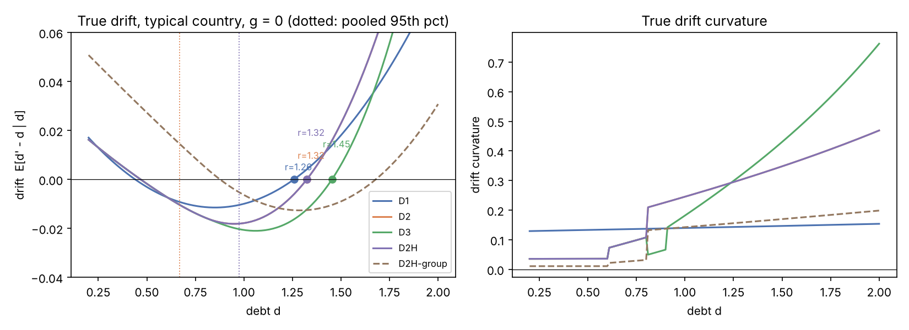
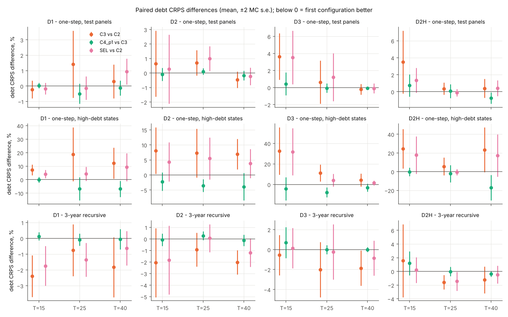
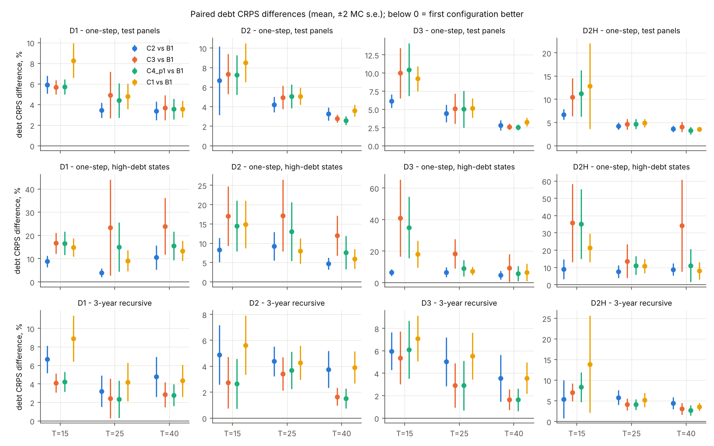
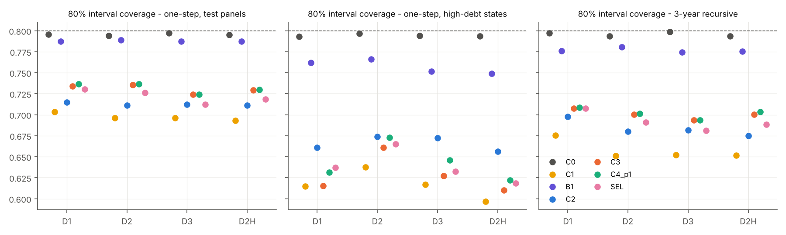
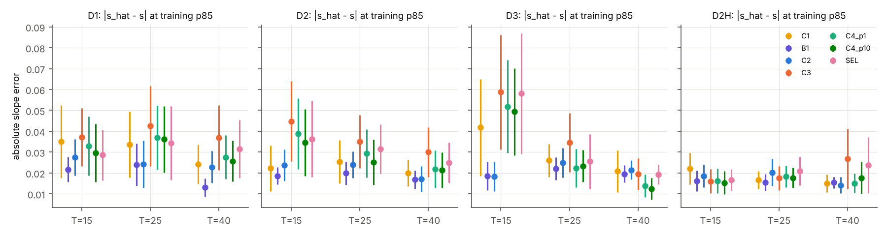
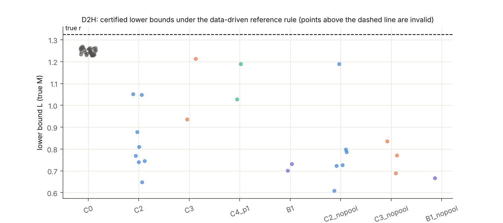
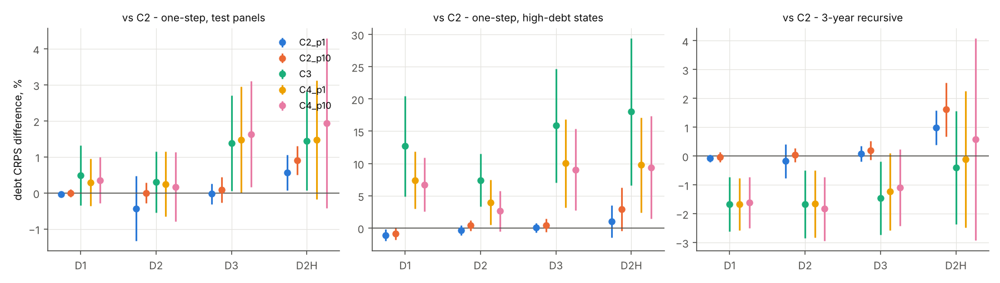

# Learning sovereign debt dynamics through the debt identity: a simulation study

All results come from a simulated data generating process (DGP) that we chose. Nothing here uses real data. The findings describe how the methods behave under this DGP and these sample sizes, not how they would behave on actual sovereign debt panels.

Code: `debtsim/` (entry point `run.py`). Tables: `results/phase3/tables/`. Figures: `results/phase1/figures/` and `results/phase3/figures/`. Main study: R = 20 replications for every design and T. Every comparison is paired within replication: the same data, the same initial network weights for the neural cells, and common random numbers for forecast draws.

## Summary

1. **The linear location-scale benchmark B1 forecasts debt best of all estimated models**, in every design, sample length and horizon. Every neural configuration has a debt CRPS 4–6% above B1's on the regular test panels, 6–28% above at high debt, and 3–8% above at three years. The main reason is calibration. The neural forecasts are too narrow out of sample: their 80% intervals cover 0.69–0.75 on the test panels and 0.56–0.69 at high debt, while B1's cover 0.72–0.80. Over the observed debt range, one-step debt dynamics in this DGP are close to linear, so the extra flexibility costs variance and buys little.
2. **Among the neural models, propagating drivers through the identity (C2) beats forecast-then-reconcile (C1).** C2's debt CRPS is 1–2% lower on the test panels and 2–4% lower at high debt (significant in most designs). Its driver pinball losses are also lower.
3. **Adding debt CRPS through the identity (C3, λ_d = 2) helps at three years and hurts at high debt.** The 3-year recursive debt CRPS falls 1.5–1.7% (significant in D1, D2 and D3). High-debt one-step CRPS rises 7–18%, every driver pinball loss gets worse, and the drift-slope error at the 85th percentile grows. It makes almost no difference on the regular test panels.
4. **The derivative penalties (C4) matter only together with the debt CRPS term.** On top of C3 they cut high-debt debt CRPS by 3–7%, improve driver and joint (energy) scores at high debt, and roughly halve C3's added slope error. They do this without hurting the regular or 3-year results. Without the CRPS term (C2 + penalties) they change almost nothing. Measured against C2, the C4 cells are still worse at high debt; the penalties repair part of the damage done by the CRPS term rather than adding a gain of their own.
5. **D3, where the primary-balance restriction is false.** In D3 the primary balance is convex only above 0.8, and only 0.1–0.4% of training observations lie there. The concavity penalty is enforced on training states above p75 (about 0.54) and collocation points up to p95 (about 0.65), where the true response is linear. So the false restriction barely binds where it is imposed and matters only when the model extrapolates. Even so, at high debt C4 is slightly worse than C3 on the misspecified dimension, the primary-balance pinball loss: +1.8% (s.e. 0.9) with penalty 10 and +1.0% (0.8) with penalty 1. Debt CRPS improves, which is consistent with the aggregate curvature restriction still holding in D3. D3 is therefore a weak test of a false restriction; a design where it binds inside the data would be a sharper one.
6. **The validation-only selection rule did not work.** Choosing the cell by validation CRPS on high-debt validation states selects close to arbitrarily: C3 is the modal choice at 20–55%. The selected model (SEL) is 5–12% worse than C2 at high debt. With only about 20 high-debt validation observations at T = 25, the criterion is too noisy to tune on.
7. **Threshold certificates are unreliable in these sample sizes.**
   - Where the true certificate does not apply (training 85th percentile, true slope negative), models rarely certify wrongly: mostly 0–10%, at most 25%.
   - Where it does apply (fixed b = 1.1, beyond the data), no model certifies in more than 42% of replications. B1 cannot certify at all, because its drift is linear with a negative slope.
   - Under the D2H data-driven reference rule, the truth itself puts a candidate b past the drift minimum in only about half of the replications. The models mostly certify at a b where the true slope is negative, and only 0–3% of replications are certified correctly.
   - The reported lower bounds L almost always lie below the true crossing r. That is largely because they are anchored at a b far below r, not because they carry information.

## 1. Data generating process

Debt follows the identity d_{t+1} = (1+i_{t+1})/(1+n_{t+1}) d_t − p_{t+1} + a_{t+1}. The drivers are generated on the scale w = (log(1+i), log(1+n), p, a) from start-of-year debt d_t and the end-of-year global factor g_{t+1}:

- log(1+i) = i0_c + k1 d + k2 max(d−0.6, 0)² + 0.004 g′ + (si0 + si1 d) e_i  (nondecreasing and convex in d)
- log(1+n) = n0_c − cn max(d−0.9, 0)² − 0.01 g′ + sn e_n
- p = p0_c + r1 d − r2 max(d−0.8, 0)² + 0.003 g′ + sp e_p  (r2 > 0: fiscal fatigue)
- a = sa e_a

The global factor g is AR(1) with ρ = 0.7 and unconditional sd 1. The shocks (e_i, e_n, e_p, e_a) come from a t-copula with df 5 and corr(e_i,e_n) = −0.3, corr(e_n,e_a) = −0.4, corr(e_n,e_p) = 0.3, others 0. Margins are normal, except e_a, which is Student t with df 4 rescaled to unit variance. Country effects are truncated normals at ±2 sd. Panels have N = 25 countries and a 50-year burn-in.

| parameter | D1 | D2 | D3 | D2H |
|---|---|---|---|---|
| i0, k1, k2 | 0.032, 0.065, 0 | 0.032, 0.018, 0.03 | 0.032, 0.018, 0.03 | 0.032, 0.018, 0.03 |
| si0, si1 | 0.0035, 0.004 | same | same | same |
| n0, cn, sn | 0.06, 0, 0.02 | 0.06, 0, 0.02 | 0.06, **0.04**, 0.02 | 0.06, 0, 0.02 |
| p0, r1, r2, sp | −0.037, 0.085, 0, 0.01 | −0.03, 0.045, 0.05, 0.01 | −0.03, 0.045, **−0.03**, 0.01 | −0.03, 0.045, 0.05, 0.01 |
| sa | 0.017 | 0.017 | 0.017 | 0.017 |
| copula / e_a margin | Gaussian / normal | t5 / t4 | t5 / t4 | t5 / t4 |
| country sd (i0, n0, p0) | 0.002, 0.003, 0.0025 | 0.003, 0.003, 0.004 | same | same |
| market-access group | none | none | none | 20%: i0 −0.010, p0 −0.037, k1,k2 × 0.3 |

- **D1 (control):** linear responses with Gaussian shocks. The drift is then quadratic in d.
- **D2 (main):** convex interest response, fiscal fatigue above 0.8, heavy tails.
- **D3 (misspecified):** nominal growth falls with debt above 0.9, and the primary balance is convex rather than concave above 0.8. C4's concavity restriction on the primary-balance coefficients is therefore **false** in D3. The aggregate restriction Δ″ ≥ 0 still holds on [b, D], because the true curvature is 0.05–0.76 there: the falling growth more than offsets the convex fiscal response. D3 therefore tests a false driver-level restriction alongside a true aggregate one, not a false aggregate restriction. The false part (d > 0.8) also lies almost entirely above the training data (0.1–0.4% of training rows), so the restriction is wrong mainly where the model extrapolates.
- **D2H (heterogeneous fiscal space):** D2 plus a market-access group. A fifth of countries pair lower interest with lower primary surpluses and a weaker risk-premium response, and sit stably at about 0.8–1.0. It was added because of the calibration constraint below.

**Calibration constraint.** In D1–D3 the drift has rising curvature, so its minimum lies at least halfway between the stable equilibrium (about 0.45) and the crossing (1.26–1.45), at about 0.86–1.06. Debt mean-reverts toward the equilibrium, so the training 85th percentile (about 0.59) always lies where the true drift slope is negative. The threshold theorem's condition s > 0 therefore fails there by construction. D2H is the variant in which the upper percentiles of pooled data can reach the typical country's drift minimum.

**Censoring.** Once a country's debt exceeds 1.6, its later transitions are dropped. This censors on the current state; the transition that crosses 1.6 is kept. No panels are redrawn. The rates are low:

| design | countries censored in burn-in (per panel) | in sample (per panel) | share of all country series | test rows dropped (of 1,250) |
|---|---|---|---|---|
| D1 | 0 | 0 | 0 | 0.17 |
| D2 | 0 | 0.017 | 0.07% | 0.83 |
| D3 | 0 | 0 | 0 | 0 |
| D2H | 0.033 | 0.033 | 0.27% | 3.3 |

In a larger Phase 1 sample (40 panels × 40 years), 0.2% of D1 and 0.7% of D2H country series were censored, and 5% and 17.5% of panels respectively contained at least one censored country.

**Ground truth** for the typical country at g = 0 uses 400,000 Monte Carlo draws with common random numbers. Derivatives are exact derivatives of the MC average, with the copula held fixed.

| design | data p50 / p85 / p95 / p99 | true crossing r | Δ(b), Δ′(b) at training p85 | curvature on [b, 2.0] |
|---|---|---|---|---|
| D1 | 0.44 / 0.56 / 0.65 / 0.80 | 1.26 | −0.006, −0.040 | 0.13–0.15 |
| D2 | 0.47 / 0.59 / 0.67 / 0.78 | 1.32 | −0.007, −0.051 | 0.04–0.47 |
| D3 | 0.47 / 0.59 / 0.67 / 0.78 | 1.45 | −0.007, −0.051 | 0.04–0.76 |
| D2H | 0.50 / 0.81 / 0.97 / 1.16 | 1.32 | −0.016, −0.031 | 0.08–0.47 |

Tests (`tests/`) check that:
- the identity holds exactly and adjustments recomputed as residuals match;
- the analytic true quantiles match simulation;
- MC drift derivatives match finite differences;
- the bounds L ≤ r ≤ U hold on 1,000 random admissible drift functions with piecewise-constant curvature in [0, M] and U ≤ D;
- model autodiff derivatives match finite differences, PIT inverts the quantile function, the identity projection is exact and minimal, and censoring drops only later transitions.

## 2. Models and protocol

All neural models share one architecture. The input is (d_t, four lagged drivers, g_t, a 3-dimensional country embedding with L2 penalty). The network has two hidden layers of 16 units with SiLU activations, and each driver head outputs 6 Bernstein coefficients, built as β₀ plus cumulative softplus increments so quantiles never cross. Training is full-batch AdamW (lr 1e-3, weight decay 1e-4). Early stopping uses the last 3 training years, with a 200-epoch minimum and patience 300. The model is then refit on all training years for the selected number of epochs.

| config | description |
|---|---|
| C0 | oracle (true DGP) |
| C1 | separate quantile networks for each driver and for the debt change d′ − d, joint draws from the frozen copula extended with debt, each draw projected onto the identity (Gauss–Newton/Lagrange, weights = inverse training error variances) |
| C2 | driver network, pinball loss at 0.05, …, 0.95, debt via the identity |
| C2_p1, C2_p10 | C2 + derivative penalties, weight 1 or 10, no debt CRPS |
| C3 | C2 + λ_d = 2 × debt CRPS (S = 64 copula draws through the identity) |
| C4_p1, C4_p10 | C3 + penalties (a) interest coefficients nondecreasing in d, (b) primary-balance coefficients concave in d above the training p75, (c) drift curvature Δ″ ≥ 0 at collocation states between the training p75 and p95 (S = 128 common draws, autodiff) |
| SEL | the cell from the grid above with the lowest validation debt CRPS on high-debt validation states (training debt above p75), using only data before the validation years |
| B1 | linear location-scale regression of d_{t+1} on (d_t, g_t, lagged drivers); for 3 years, a direct regression of d_{t+3} on the same inputs |

**Copula.** C2-type PITs are computed with forward cross-fitting (3 year blocks) and stored as rank vectors by year. Sampling draws whole years, with uniform jitter. The copula is frozen for C2–C4; validation-stage training uses a copula built from pre-validation years only.

**Grid.** All six cells of λ_d ∈ {0, 2} × penalty ∈ {0, 1, 10} are reported, so no single tuning value is fixed. The (0, 0) cell is C2.

**Evaluation.** Each replication is evaluated on three sets:
- 10 independent 5-year continuation panels from the end-of-training state, up to 1,250 one-step origins, so year shocks are not shared across the whole test set;
- 500 high-debt states (debt between the training 90th percentile and the training maximum + 0.1, drawn from the DGP);
- 3-year recursive forecasts from 750 test origins, simulating drivers and debt along paths, with g from a training-estimated AR(1).

All metrics use S = 500 draws.

**Implementation choices that matter:**
- The embedding L2 weight is 1.0. With 0.01 the embedding overfit, and C1's debt model learned spurious mean reversion.
- The Bernstein heads are initialised to a centred quantile function. The default initialisation put the median about 1.7 sd off-centre and early stopping froze it there.
- C1 models the debt change rather than the level.

**Runtime.** About 185–205 s of fitting plus 36–58 s of evaluation per replication on one core; R = 20 for 4 designs × 3 T took 3.9 hours on 4 cores.

## 3. Main results: debt CRPS

The entries are mean paired differences in debt CRPS, as a percentage of the comparator's mean CRPS. MC standard errors are in parentheses, and * marks |mean| > 2 s.e. Negative values favour the first configuration. Figures are averaged over T, with 60 paired replications per design.

| comparison | set | D1 | D2 | D2H | D3 |
|:--|:--|:--|:--|:--|:--|
| C3 vs C2 | test | +0.5 (0.4) | +0.3 (0.4) | +1.4 (0.7)* | +1.4 (0.7)* |
| C3 vs C2 | high | +12.7 (3.9)* | +7.4 (2.0)* | +18.0 (5.7)* | +15.9 (4.4)* |
| C3 vs C2 | 3-yr | −1.7 (0.5)* | −1.7 (0.6)* | −0.4 (1.0) | −1.5 (0.6)* |
| C4_p1 vs C3 | test | −0.2 (0.1) | −0.1 (0.1) | +0.0 (0.3) | +0.1 (0.2) |
| C4_p1 vs C3 | high | −4.7 (1.9)* | −3.2 (0.9)* | −7.0 (3.1)* | −5.1 (2.3)* |
| C4_p1 vs C3 | 3-yr | −0.0 (0.1) | +0.0 (0.1) | +0.3 (0.3) | +0.2 (0.3) |
| C4_p10 vs C3 | high | −5.3 (2.0)* | −4.5 (1.1)* | −7.3 (3.7) | −5.9 (2.4)* |
| C2_p1 vs C2 | high | −1.1 (0.5)* | −0.4 (0.4) | +1.0 (1.2) | +0.0 (0.4) |
| SEL vs C2 | high | +5.9 (2.0)* | +4.6 (1.8)* | +11.7 (5.2)* | +12.4 (4.3)* |
| C2 vs C1 | test | −1.2 (0.3)* | −1.0 (0.4)* | −2.1 (1.5) | −1.3 (0.4)* |
| C2 vs C1 | high | −4.2 (1.1)* | −2.0 (1.3) | −4.3 (2.1)* | −4.3 (1.5)* |
| C2 vs B1 | test | +4.3 (0.3)* | +4.7 (0.6)* | +4.9 (0.3)* | +4.5 (0.3)* |
| C2 vs B1 | high | +7.7 (1.0)* | +7.4 (0.9)* | +8.5 (1.3)* | +5.9 (0.8)* |
| C2 vs B1 | 3-yr | +4.9 (0.5)* | +4.4 (0.5)* | +5.2 (0.9)* | +4.9 (0.6)* |
| C4_p1 vs B1 | high | +15.7 (2.2)* | +11.7 (1.8)* | +19.1 (4.0)* | +16.5 (3.8)* |
| C1 vs B1 | test | +5.5 (0.5)* | +5.7 (0.5)* | +7.1 (1.6)* | +5.9 (0.5)* |
| B1 vs C0 | test | +1.5 (0.1)* | +1.9 (0.1)* | +2.0 (0.1)* | +2.0 (0.1)* |
| B1 vs C0 | high | +3.6 (0.4)* | +4.5 (0.4)* | +8.4 (0.9)* | +4.7 (0.4)* |
| C2 vs C0 | high | +11.6 (1.1)* | +12.3 (1.2)* | +17.6 (1.3)* | +11.0 (0.8)* |

The full table, including C3/C4 against C1 and B1 and the 3-year rows, is `tables/summary_by_design.md`. Tables by design and T: `crps_main_{test,high,rec3}.md`, `crps_vs_bench_*.md` and `crps_vs_oracle_*.md`.

**By sample length.**
- **C3 vs C2 at high debt:** the harm is not concentrated at small T. In D2 it is +8.1 (3.9), +7.3 (4.0) and +6.9 (2.5) at T = 15, 25 and 40, and in D3 +32.4 (11.5), +11.0 (4.1) and +4.2 (3.1). Small samples make it worse in D3.
- **C3's 3-year gain:** it is similar across T. In D2 it is −2.1 (1.5), −0.9 (0.7) and −2.0 (0.5).
- **The gap to B1:** it shrinks with T. In D2 on the test panels, C2 vs B1 falls from +6.7% at T = 15 to +3.3% at T = 40, but it never closes.

**Calibration (80% interval coverage, averaged over T).**

| set | C0 | C1 | B1 | C2 | C3 | C4_p1 |
|---|---|---|---|---|---|---|
| test | 0.79–0.80 | 0.69–0.70 | 0.79 | 0.71 | 0.72–0.74 | 0.72–0.74 |
| high | 0.79–0.80 | 0.60–0.64 | 0.75–0.77 | 0.66–0.67 | 0.61–0.66 | 0.62–0.67 |
| 3-yr | 0.79–0.80 | 0.65–0.68 | 0.77–0.78 | 0.67–0.70 | 0.69–0.71 | 0.69–0.71 |

(Ranges are across designs.)

The neural models are under-dispersed out of sample, most of all at high debt. In-sample coverage of the driver quantiles was close to nominal in the Phase 2 check (one replication), so the shortfall looks like overfitting: the networks track training-period country and year patterns that do not persist. C3 widens the debt intervals on the test panels, which raises coverage, but at high debt its intervals are no wider than C2's and are mislocated.

## 4. Do debt gains come at the expense of drivers?

At high debt, the answer for C3 is yes. Its driver pinball losses and joint energy score over (drivers, debt) are worse than C2's in D1, D2 and D3: driver pinball +10.1%, +3.7% and +8.5%; energy +8.4%, +3.0% and +7.6%. That matches its worse high-debt debt CRPS. The penalties then improve every driver except the primary balance in D3 (`tables/drivers_high_by_design.md`). On the regular test panels, C3's driver pinball losses are 1–3% worse than C2's.

| high-debt pinball, C4 vs C3 | D1 | D2 | D2H | D3 |
|---|---|---|---|---|
| interest, p1 | −0.5 (0.6) | −2.3 (0.5)* | −23.2 (2.1)* | −2.6 (0.8)* |
| primary balance, p1 | −3.1 (1.3)* | −0.5 (0.8) | −8.6 (1.7)* | **+1.0 (0.8)** |
| primary balance, p10 | −2.5 (1.4) | +0.8 (0.9) | −7.3 (1.8)* | **+1.8 (0.9)*** |
| all drivers, p10 | −2.3 (0.8)* | −1.9 (0.5)* | −11.8 (1.4)* | −2.2 (1.1)* |

**D3, the false restriction.** The concavity penalty on primary-balance coefficients is the only driver dimension where C4 moves away from C3 in the wrong direction. The harm is small (+1–2%) and significant only at weight 10. Everything else, including debt CRPS, improves. The restriction is enforced where the true primary balance is linear (training states above p75, about 0.54, and collocation points up to p95, about 0.65), so it is almost satisfied there. It is false only above 0.8, where 0.1–0.4% of training data lie but part of the high-debt test set does (up to the training maximum + 0.1). The small harm is the model carrying concavity into that region.

D2H is a special case. C4's interest pinball is 23% lower than C3's there. A likely explanation, which we did not test, is that pooling with the market-access countries, whose rates respond weakly to debt, lets the unpenalised fits produce non-monotonic interest responses at high debt.

## 5. Drift derivatives at the reference point (training p85)

Absolute errors |v̂ − v| and |ŝ − s| are × 1000 and averaged over T. Full tables by T are `deriv_err_v.md` and `deriv_err_s.md`.

| comparison (err_s × 1000) | D1 | D2 | D2H | D3 |
|---|---|---|---|---|
| C3 vs C2 | +14.0 (4.5)* | +15.0 (5.1)* | +2.5 (3.2) | +16.0 (6.5)* |
| C4_p1 vs C3 | −6.4 (1.8)* | −6.6 (1.9)* | −3.6 (2.2) | −8.2 (3.4)* |
| C4_p10 vs C3 | −8.4 (2.0)* | −9.6 (2.3)* | −3.3 (1.9) | −9.2 (3.5)* |
| C2 vs B1 | +5.3 (2.7) | +3.2 (1.7) | +2.0 (1.4) | +1.5 (1.2) |

Typical slope errors are 0.013–0.06 against a true slope of about −0.05 at p85, so even the best estimates are imprecise. B1, whose drift is linear in d, has the smallest or near-smallest slope errors at p85 in most cells. The debt CRPS term distorts the slope, and the penalties undo part of that distortion.

In D2H, every model's level error |v̂ − v| is large (about 0.015). The pooled models answer for an average of typical and market-access countries, not for the typical country with a zero embedding.

## 6. Threshold results

**Threshold design A: specified DGP, b = training p85, where the true certificate does not apply.** The table shows false certification rates, averaged over T (by T: `false_cert_p85.md`).

| | B1 | C1 | C2 | C2_p10 | C3 | C4_p1 | C4_p10 | SEL |
|---|---|---|---|---|---|---|---|---|
| D1 | 0.08 | 0.08 | 0.13 | 0.13 | 0.05 | 0.05 | 0.05 | 0.07 |
| D2 | 0 | 0 | 0.03 | 0.05 | 0.02 | 0.02 | 0.02 | 0.02 |
| D3 | 0 | 0 | 0.02 | 0.02 | 0 | 0 | 0 | 0 |
| D2H | 0 | 0.02 | 0.02 | 0.03 | 0.02 | 0 | 0 | 0 |

The certificate is usually withheld correctly. The highest false-certification rates are C2 and C2+penalties in D1 at T = 40 (0.20–0.25). Adding the debt CRPS term lowers them.

**Secondary diagnostic: b = 1.1, beyond the data, where the true certificate applies.** The full table is `tables/fixed_b.md`.

| | certified | among certified: L ≤ r (true M) | among certified: r ∈ [L, U] |
|---|---|---|---|
| D2: C2 / C3 / C4_p1 / C4_p10 / B1 | 0.18 / 0.08 / 0.12 / 0.17 / 0.00 | 0.91 / 1.00 / 0.86 / 0.80 / – | 0.27 / 0.60 / 0.43 / 0.30 / – |
| D3: C2 / C3 / C4_p1 / C2_p10 / B1 | 0.30 / 0.08 / 0.07 / 0.42 / 0.00 | 1.00 / 1.00 / 1.00 / 1.00 / – | 0.17 / 0.00 / 0.00 / 0.24 / – |

- **Extrapolation:** the models rarely extrapolate the turn of the drift. When they do certify, the lower bound with the true M is usually valid, but the two-sided interval contains r in at most 60% of certified cases.
- **Wrong M:** with M = 0.24, below the true maximum curvature on [1.1, 2.0], even the oracle's L exceeds r in D2, D2H and D3. That illustrates that the bound is only as good as the curvature bound fed into it.
- **D3:** the penalty-only cells certify most often (0.38–0.42), but the two-sided coverage stays low.

**Threshold design B: D2H data-driven reference.** The rule picks the lowest training percentile in {75, 85, 90, 95} where the model's own slope is positive and local support holds (at least 20 observations from at least 3 countries within ±0.1); otherwise it withholds. The full tables are `rule_d2h.md`, `rule_d2h_T.md` and `rule_d2h_pct.md`.

| config | b chosen | certified | correctly certified | median b \| cert | median L (true M) \| cert | r ∈ [L,U] \| cert |
|---|---|---|---|---|---|---|
| C0 (truth) | 0.50 | 0.50 | 0.50 | 0.99 | 1.25 | 0.17 |
| C2 | 0.27 | 0.13 | 0.00 | 0.74 | 0.79 | 0.12 |
| C2_p10 | 0.77 | 0.30 | 0.03 | 0.75 | 0.83 | 0.06 |
| C3 | 0.05 | 0.03 | 0.02 | 0.95 | 1.07 | 0.00 |
| C4_p1 | 0.05 | 0.03 | 0.03 | 0.98 | 1.11 | 0.50 |
| SEL | 0.20 | 0.10 | 0.03 | 0.83 | 0.93 | 0.33 |
| B1 | 0.07 | 0.03 | 0.00 | 0.65 | 0.72 | 0.00 |
| C2, no pooling | 0.13 | 0.10 | 0.02 | 0.61 | 0.76 | 0.00 |
| C3, no pooling | 0.05 | 0.05 | 0.00 | 0.63 | 0.77 | 0.33 |

- **The truth itself:** a positive slope with local support exists at a candidate percentile in only 50% of replications, because the 95th percentile straddles the drift minimum (about 0.95).
- **When the oracle certifies:** its L with the true M is tight (median 1.25 vs r = 1.32), but U exceeds D = 2 in most cases, so the two-sided interval is rarely available.
- **The models:** most model certifications happen at a b where the true slope is negative, typically p75 for C2 and its penalty variants, so they are wrong certifications. Their L, anchored near b, is trivially below r. One-sided "coverage" here is uninformative and should not be read as success.
- **C3 and C4:** they certify rarely (3–5%), but when they do it is at high b and is usually correct.
- **Pooling:** without the high-debt countries, the models can no longer reach the region where the slope turns. Certifications fall and sit at lower b. B1 cannot use pooling at all, because its slope is common to all debt levels.

## 7. Tuning grid and selection rule

The grid against C2 (debt CRPS %, averaged over T; `tables/grid_crps.md`):

| cell vs C2 | test D2 | high D2 | 3-yr D2 | high D3 | high D2H |
|---|---|---|---|---|---|
| C2_p1 (λ 0, pen 1) | −0.4 (0.5) | −0.4 (0.4) | −0.2 (0.3) | +0.0 (0.4) | +1.0 (1.2) |
| C2_p10 (λ 0, pen 10) | +0.0 (0.1) | +0.4 (0.4) | +0.0 (0.1) | +0.4 (0.5) | +2.9 (1.7) |
| C3 (λ 2, pen 0) | +0.3 (0.4) | +7.4 (2.0)* | −1.7 (0.6)* | +15.9 (4.4)* | +18.0 (5.7)* |
| C4_p1 (λ 2, pen 1) | +0.2 (0.5) | +4.0 (1.7)* | −1.7 (0.6)* | +10.0 (3.4)* | +9.8 (3.7)* |
| C4_p10 (λ 2, pen 10) | +0.2 (0.5) | +2.6 (1.6) | −1.8 (0.6)* | +9.1 (3.2)* | +9.4 (4.0)* |

The cells trade off the same way in every design. The CRPS term helps at three years and hurts at high debt, and penalties shrink the high-debt harm. No cell beats C2 at high debt.

Selection frequencies (`tables/selection.md`) are spread across all six cells, so the validation-only rule picks close to arbitrarily. SEL is no better than C2 on the test panels, slightly better at three years in D1 (−1.3%), and worse at high debt.

## 8. Where each component helps, does nothing, or hurts

| component | helps | does nothing | hurts |
|---|---|---|---|
| Identity propagation (C2 vs C1) | debt CRPS (1–4%), driver losses, especially at high debt and small T | 3-yr in D2, D3 | – |
| Debt CRPS through the identity (C3 vs C2) | 3-yr recursive debt CRPS (about −1.5%), test-set interval coverage | one-step test CRPS | high-debt debt CRPS (+7 to +18%), high-debt driver and energy scores, drift-slope error |
| Penalties without CRPS (C2_p vs C2) | – | nearly everything | small losses in D2H |
| Penalties with CRPS (C4 vs C3) | high-debt debt CRPS (−3 to −7%), driver and energy scores, slope error | test and 3-yr CRPS | primary-balance loss in D3 (+1 to +2%, the false restriction) |
| Validation-only selection | 3-yr in D1 | test | high debt (selection noise) |
| Neural vs linear benchmark B1 | – | – | every debt-CRPS comparison (4–28% worse) |
| Threshold certificate | correct withholding at p85 | – | certification beyond the data is rare; the D2H rule certifies mostly at the wrong b |

Expected patterns, checked rather than forced:
- **Little difference in D1:** partly confirmed. On the test panels the differences are under 1.5%, but C3's high-debt harm and C4's partial repair appear in D1 just as in D2.
- **Gains from C3 and C4 mainly at small T and high debt in D2:** **not confirmed.** C3 hurts at high debt at every T. C4 only partially undoes that harm, and its gains are relative to C3, not to C2.
- **C4 hurting or neutral in D3 on the misspecified dimension:** confirmed, but weakly tested. The primary-balance loss at high debt is slightly worse while the other dimensions improve, and the false part of the restriction lies almost entirely outside the training data.

## 9. Caveats

- **The DGP is ours.** In particular:
  - one-step debt dynamics are close to linear over the observed range;
  - the drift turns only well beyond the data;
  - the lagged drivers that the models condition on carry no information in the DGP.

  Each of these favours B1 and makes the derivative and threshold tasks very hard. A DGP with stronger nonlinearity inside the data range, or with informative lags, could reverse the ranking.
- **The neural models are miscalibrated as specified.** A tiny network, a country embedding and early stopping on 3 years produce out-of-sample under-dispersion. Better regularisation or post-hoc recalibration of the driver quantiles might change the B1 comparison. We did not try either, to keep to the specification.
- **R = 20 per cell for D1 and D3.** Many high-debt differences there have standard errors of 2–10 percentage points, and statements about small T cells (T = 15) rest on 20 replications. D2 and D2H were extended to R = 100 (Section 10), which confirmed the R = 20 conclusions.
- **High-debt test states and continuation panels are drawn from the true DGP** given the replication's country effects. The high-debt states run up to 0.1 above the training maximum, so they include mild extrapolation.
- **Tuning:** none of the grid values was chosen by looking at test results. The grid is reported in full, and the only tuning rule evaluated (SEL) uses validation data only.

## 10. R = 100 extension (D2 and D2H)

D2 and D2H were rerun with R = 100 replications per T: 600 replications in total, the first 20 of each cell being the main-study replications. Tables are in `results/phase3/tables_r100/` and figures in `results/phase3/figures_r100/`. Averaged over T, each design has 300 paired replications. Standard errors are about half those at R = 20.

| comparison | set | D2, R = 20 | D2, R = 100 | D2H, R = 20 | D2H, R = 100 |
|:--|:--|:--|:--|:--|:--|
| C3 vs C2 | test | +0.3 (0.4) | +0.6 (0.2)* | +1.4 (0.7)* | +1.2 (0.3)* |
| C3 vs C2 | high | +7.4 (2.0)* | +11.2 (2.1)* | +18.0 (5.7)* | +19.8 (3.2)* |
| C3 vs C2 | 3-yr | −1.7 (0.6)* | −1.6 (0.3)* | −0.4 (1.0) | −0.6 (0.3) |
| C4_p1 vs C3 | high | −3.2 (0.9)* | −5.1 (1.2)* | −7.0 (3.1)* | −6.8 (1.8)* |
| C4_p10 vs C3 | high | −4.5 (1.1)* | −5.8 (1.2)* | −7.3 (3.7) | −8.8 (1.9)* |
| C2_p1 vs C2 | high | −0.4 (0.4) | −0.2 (0.2) | +1.0 (1.2) | +0.3 (1.0) |
| SEL vs C2 | high | +4.6 (1.8)* | +7.3 (1.8)* | +11.7 (5.2)* | +13.4 (2.6)* |
| C2 vs C1 | test | −1.0 (0.4)* | −0.9 (0.1)* | −2.1 (1.5) | −1.1 (0.3)* |
| C2 vs C1 | high | −2.0 (1.3) | −2.3 (0.6)* | −4.3 (2.1)* | −4.4 (1.3)* |
| C2 vs B1 | test | +4.7 (0.6)* | +4.5 (0.2)* | +4.9 (0.3)* | +4.7 (0.2)* |
| C2 vs B1 | high | +7.4 (0.9)* | +7.1 (0.4)* | +8.5 (1.3)* | +10.5 (1.2)* |
| C2 vs B1 | 3-yr | +4.4 (0.5)* | +4.9 (0.4)* | +5.2 (0.9)* | +5.0 (0.4)* |

**What changes with R = 100:**
- **No sign changes.** Every conclusion in Sections 3–8 holds for D2 and D2H.
- **C3 at high debt is worse than R = 20 suggested.** In D2 the harm is +11.2% (2.1), and it is largest at small T: +18.4 (5.7), +7.2 (2.1) and +7.8 (1.8) at T = 15, 25 and 40. The expected pattern "C3 gains mainly at small T and high debt" is reversed under this DGP: small T and high debt are where it hurts most.
- **C3 on the regular test panels.** The +0.6% (0.2) increase, within noise at R = 20, is now significant.
- **C4 vs C3 at high debt.** The penalty repair is −5 to −9% and significant in both designs. C4 remains worse than C2 at high debt.
- **C2 + penalties alone** is indistinguishable from C2 at high debt.
- **The SEL rule** is again worse than C2 at high debt (+7% and +13%). Its choices stay spread across all six cells, with C3 the modal choice at 25–37%.
- **The gap to B1** is unchanged, at 4.5–5% on the test panels and 7–10% at high debt.
- **Calibration** is unchanged: 80% coverage on the test panels is 0.71–0.73 for the neural models and 0.79 for B1; at high debt it is 0.61–0.66 against 0.74–0.76.

**Drivers at high debt** (R = 100):
- C3 vs C2 worsens pinball losses for growth (+9.5% D2, +11.3% D2H) and adjustments (+9.7%, +6.3%), and the energy score (+5.4%, +3.6%).
- C4 vs C3 improves interest (−2.5% D2, −25% D2H) and the energy score (−2.0%, −13%).

**Derivatives at p85** (R = 100, × 1000):
- C3 vs C2 raises the slope error by +9.9 (2.5) in D2 and +3.7 (1.7) in D2H.
- C4_p1 vs C3 lowers it by −7.0 (1.4) and −3.9 (1.2).
- B1's slope error is significantly smaller than C2's in both designs: by 4.2 (0.8) and 2.9 (0.8).

**Thresholds** (R = 100):
- **False certification at p85** stays low: at most 2% in D2, and 10–11% for the C2 + penalty cells in D2H.
- **At b = 1.1 in D2**, the certification rates are C2 0.24, C2_p10 0.30, C3 0.10, C4_p1 0.13, SEL 0.15 and B1 0.
- **Under the D2H rule**, the oracle again finds a usable b in 50% of replications. Models certify correctly in 0–5% of replications, and certifications by the C2 cells still sit mostly at b where the true slope is negative.
- **Pooling:** without the high-debt countries, certifications fall further (C2 10%, C3 5%, B1 1%), at a lower median b (0.58–0.67).
